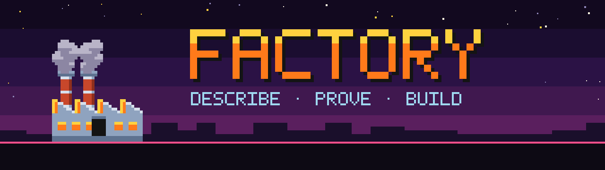
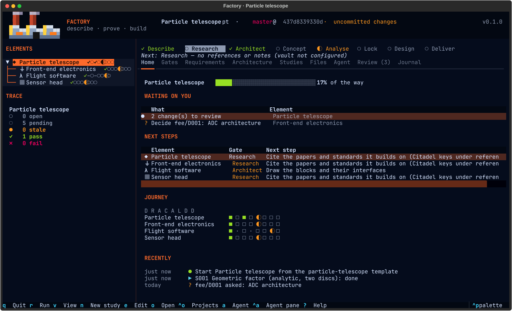

<p align="center"></p>

# Factory

A universal development workbench for Omarchy. A product is a tree of **elements**
(system → subsystems → components); every element goes through the same loop —
Describe · Research · Architect · Concept · Analyse · Lock · Design · Deliver — with each
gate's status computed from what exists. Requirements carry criteria on metrics; studies
run module tasks (Geant4, IRENE AE9/AP9, PIC, ngspice, KiCad, pytest, scripts…) and record runs whose
metrics pass or fail them; derived requirements roll up to their parents; any change marks
what depends on it stale. Notes and reports live in the Obsidian vault, papers in Citadel,
design data in the project's git repo.

See [PLAN.md](PLAN.md) for the vision, the model and the phases.

<p align="center"></p>

Tabs: **Home** · Gates · Requirements · Architecture · **Studies** (each study's runs, outputs
and log beside it) · Files · **Agent** · Review · Journal, on `1`…`9`. `m` shows the project's
**tools**: the modules it uses (enabled, or needed by a study), whether each tool is installed
on this machine and how to install it; `e` there enables or disables a module; `Ctrl+P` finds any action by name; `?` lists the keys.
`R` shows **requests** to your tools (below).
Passing a gate, locking a baseline or approving a proposal makes the factory in the top bar
puff smoke and light its windows.

```bash
python3 -m venv .venv && .venv/bin/pip install -e '.[dev]'
.venv/bin/factory templates
.venv/bin/factory new ptel -t hardware   # or software, publication; under ~/Hardware
.venv/bin/factory status -C ~/Hardware/ptel
.venv/bin/factory run S001 --wait -C ~/Hardware/ptel
.venv/bin/factory arch -C ~/Hardware/ptel
.venv/bin/factory -C ~/Hardware/ptel               # TUI
.venv/bin/pytest
```

## Home and journal

Factory opens on **Home**, which answers "what now?" for the whole project:

- **Waiting on you:** changes to review, open decisions, failed or stale studies,
  and elements changed since their lock. Enter takes you there.
- **Next steps:** each element's current gate and what it needs. Enter opens that element.
- **Journey:** every element's eight gates as a row of cells, plus the project's progress.
- **Recently:** the latest entries in the **Journal**.

The Journal tab (`9`) is the project's timeline: approvals, locks, decisions, runs,
discarded changes and gates passed. A toast marks each gate as it passes.

```bash
factory home          # the same summary; --json for agents
factory next          # each element's next step
factory journal --since 7 --md > handover.md
```

## Guided gates

The **Gates** tab (`2`) shows the selected element's gates, and under each one not yet
done, a short checklist of what is left. Everything is computed from the files:
"Write its requirements", "Allocate every requirement to a block", "Run the studies and
keep them up to date", and so on. On an item:

- `space` or `enter` **does it yourself**: the editor on the right file (created from a
  stub if needed), a new requirement, the New Study dialog, the right tab, or lock.
- `a` **hands the gate to an agent**: the brief carries the gate's open items and its
  **playbook**, a short recipe for running that gate. Factory ships one per gate. Put
  your own in `playbooks/<gate>.md` in the project to change how your team works.

```bash
factory gates fee            # the gates with their checklists
factory agent fee -g analyse # an agent session on that gate (--print shows the brief)
```

## New projects

`Ctrl+O` → *New project from a template…* asks for a name, **the idea**, a template and a
**location**: type it, or press `Browse…` (`Ctrl+B`) for the desktop's folder chooser. The
project gets its own folder, named after it, inside that location; the dialog shows the
full path before you create it.

The idea is what you want to make, in your words. It becomes the system's description, and
the project opens with a **kickoff**: the agent interviews you (a few questions at a time),
then drafts the description, the requirements that drive the design, a first architecture
and the open trade-offs as decisions, all waiting for you in Review.
`factory new cubesat-camera --idea "A 3U camera that images wildfires from LEO"` does the
same from the command line; the kickoff starts when Factory first opens the project.

## Working with an agent

The agent works inside Factory. Press `a` and the selected element's agent starts in the
**agent pane**, briefed on the element (on a Gates item: on that gate, with its playbook).
The pane is a drawer beside any tab (`Ctrl+A` shows, focuses and hides it) and the
**Agent** tab (`7`). Each element keeps its own conversation; reopen Factory and `a` picks
it up where it was.

Any agent that speaks the [Agent Client Protocol](https://agentclientprotocol.com) works:

| Agent | `[agent] default` | Started with |
|---|---|---|
| Claude Code (default) | `claude` | `claude-agent-acp`, else `npx -y @agentclientprotocol/claude-agent-acp` |
| GitHub Copilot | `copilot` | `copilot --acp` |
| opencode | `opencode` | `opencode acp` |
| Codex | `codex` | `codex-acp`, else `npx -y @zed-industries/codex-acp` |

Pick yours in `~/.config/factory/config.toml`, or per project in `factory.toml`:

```toml
[agent]
default = "copilot"

[agents.mine]            # any other ACP agent
command = ["my-agent", "--acp"]
```

Factory answers the agent's permission requests itself. Reading and editing inside the
project are allowed; commands and anything outside the project are asked in the pane
(`y` allow, `n` deny, `s` always allow that command this session). Committing, pushing,
resetting, tagging, locking and deciding are always refused: the agent's changes wait in
the Review tab (`8`) with `.factory/proposal.md`, its handover to the next session. Every
project carries `AGENTS.md` (and `CLAUDE.md`, which imports it) with these rules, and
`factory skill install` gives Claude Code, Copilot and others the `factory` skill.

### Requests to your tools

The agent works with your other tools (Citadel, Materia, Factory's modules) and does not
work around one that falls short. It files a request instead, a feature, bug, material,
data or update for that tool, and names it in its proposal:

```sh
factory request "Geant4 task: per-layer energy deposit" --to factory -k feature -e detector \
  -d "S005 needs the deposit in each layer; the task only reports the total."
factory requests                      # what is waiting, from every project
```

Requests from every project collect in `~/.local/share/factory/requests`, one Markdown file
each. A request can go to Factory or to any git repository beside it (`~/Projects/materia`…),
or to one named under `[tools]` in the config. Home lists what needs you; `R` lists every
request:

| Key | |
|---|---|
| `enter` | hand the request to a development session: your agent, in the tool's repository, briefed with it |
| `y` | accept the delivered change: merge its pull request (or branch) and update the checkout |
| `x` | reject it, with a reason: its pull request is closed |
| `d` | open its pull request |

When Herdr runs, the session opens as a tab in the tool's Herdr
workspace (`factory-dev`, `citadel-dev`…, created if missing), where you watch it, steer it
and answer its prompts. Otherwise it gets a terminal window. The session works by the
repository's `AGENTS.md` (Factory, Citadel and Materia each have one: a branch, a failing
test first, green checks, docs, a pull request), or by the same loop when a repository has
none. It proposes before it builds, never merges, and hands back with
`factory requests --close ID --branch B --pr URL -n "<what changed>"`, or declines a request
that does not belong in its tool.

Once you accept or reject (or the tool declines), Home says so: `enter` tells the project's
agent, to pick the change up, or to find another way.

### Reviewing the agent's work

The Review tab (`8`) works like a pull request. The proposal sits on top; below it, every
changed file with its diff. Go through the files and mark each one:

| Key | |
|---|---|
| `y` | accept the file (again to undo) |
| `x` | reject it: it will be discarded |
| `c` | comment: what the agent should change (the file stays pending) |
| `Y` | accept every file not yet marked or commented |
| `S` | submit the review |

Submitting commits the accepted files (with the proposal's title as the message, which you
can edit), discards the rejected ones, and sends your comments, plus any overall feedback,
to the agent, which revises and stops again for review. Marks are kept in
`.factory/review.json` until you submit, so a review can span sessions. `enter` on a
decision answers it.

`A` opens Claude Code in its own terminal window instead, as before:

```bash
factory agent fee -t "size the ADC"   # new session (-w: own window)
factory agent --continue              # resume the last session; --fork resumes a copy
factory agent --sessions              # saved and running sessions
```

## Radiation environment (IRENE)

`tools/build-irene` builds AFRL's IRENE (AE9/AP9/SPM) from its source distribution into
`~/.local/opt/irene/<version>` and adds an `irene` command. A study with
`task = "irene.environment"` takes orbit elements, models (AE9, AP9, AE8, AP8) and a statistic
(mean, a percentile, or a Monte Carlo confidence level) and writes orbit-average/peak spectra,
Geant4 GPS source macros and total dose behind aluminium (`tid_<d>mm` metrics).

## Writing a module

A module is a `factory.modules.api.Module` with tasks, tools, viewers, element kinds, file
kinds, toolchains and checks. Built-ins live in `src/factory/modules/`; external packages
register through the `factory.modules` entry-point group. A task builds a `Command` from a
`RunContext`; Factory runs it, logs it, and reads `metrics.json` plus the task's `collect`.
